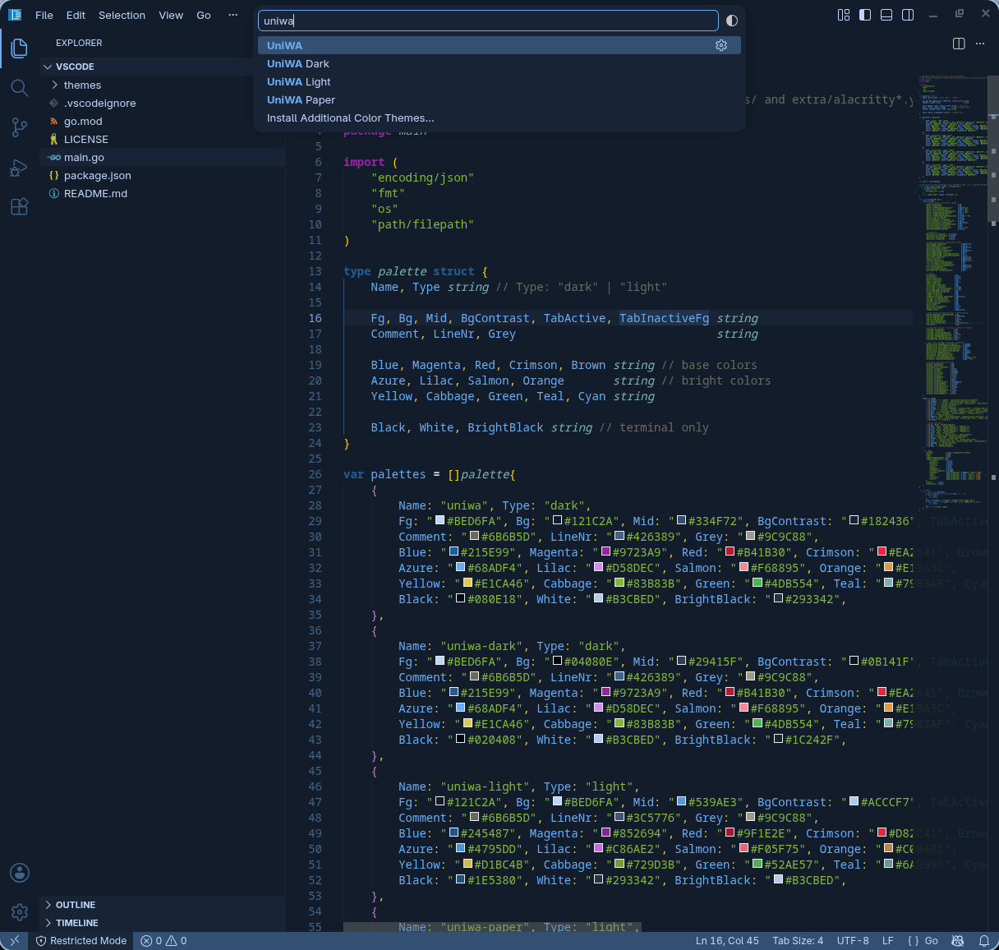
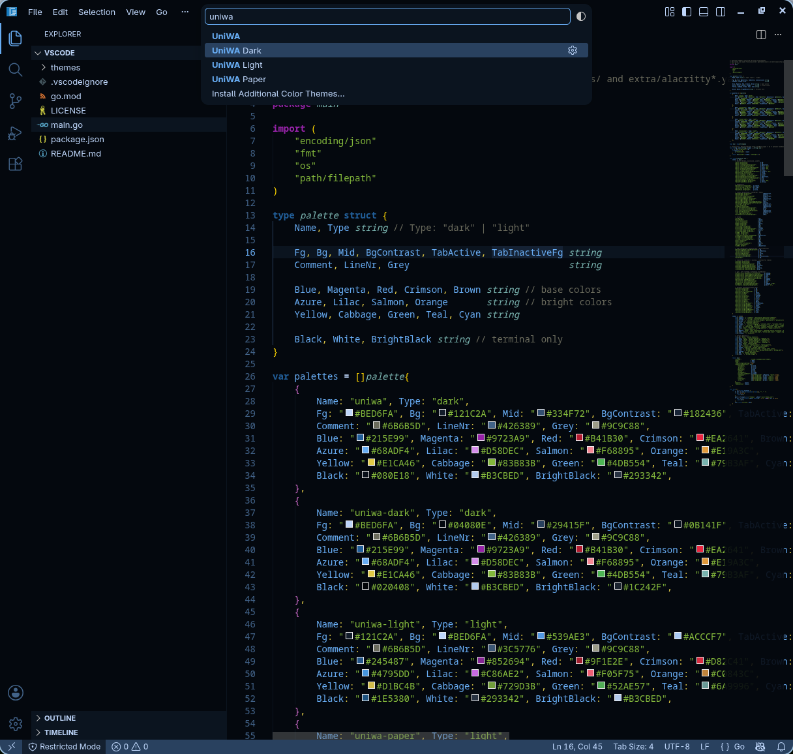
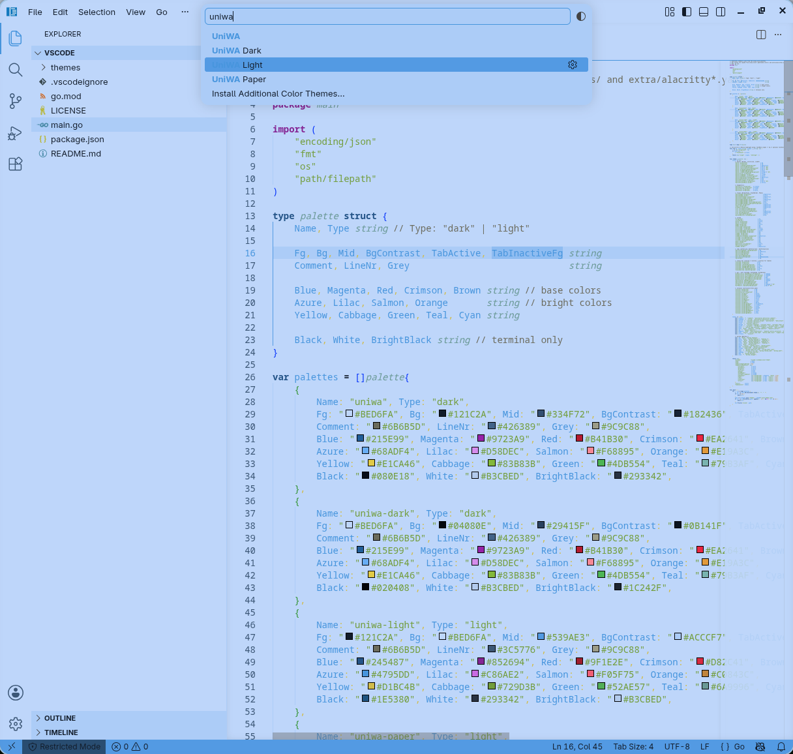
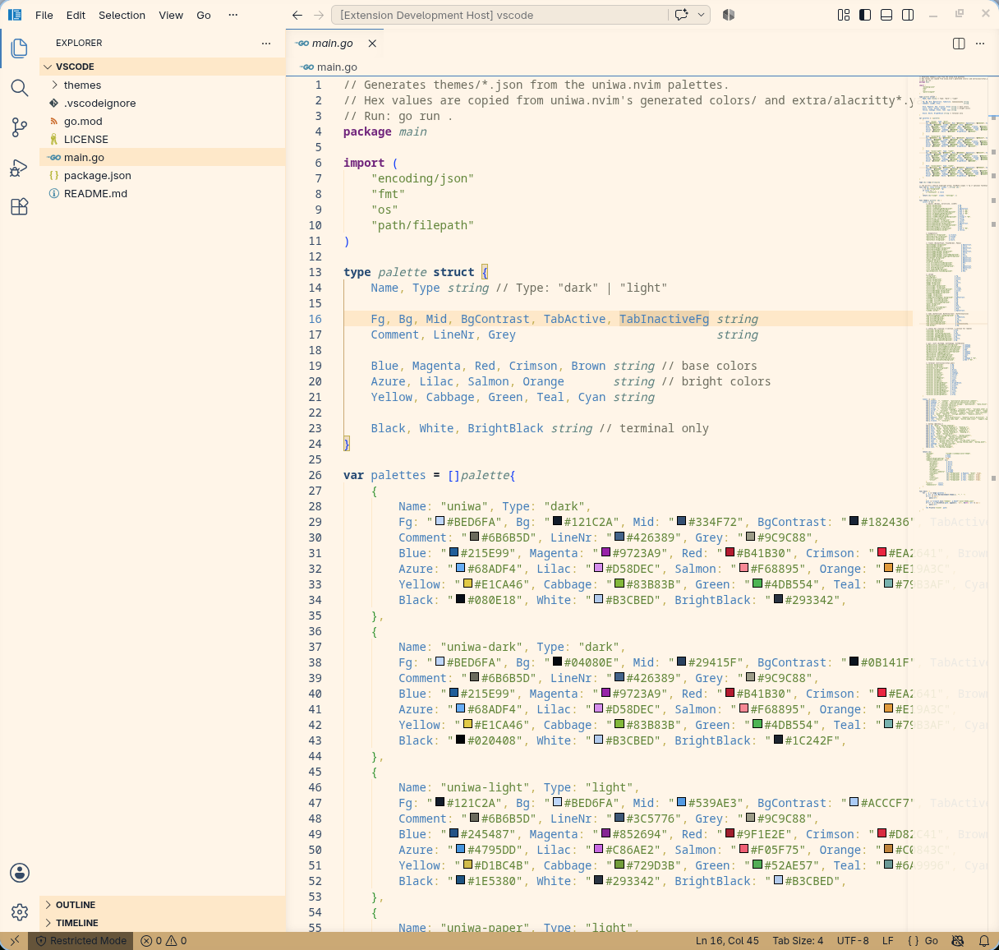

# uniwa-vscode-theme

| UniWA | UniWA Dark |
|---|---|
|  |  |
| **UniWA Light** | **UniWA Paper** |
|  |  |

`main.go` replicates what [uniwa.nvim](https://github.com/uniwa-community/uniwa.nvim) does with Lush/Shipwright, written from scratch since VS Code has no equivalent library.
